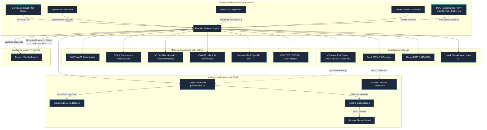

# 🛡️ Centinela-AI: Plataforma Omni-XDR & AI Governance

Centinela-AI es la plataforma **Omni-XDR (Extended Detection and Response) & AI Governance de Alta Fidelidad**. Diseñada bajo un enfoque defensivo estricto, actúa como el centro neurálgico para la correlación de telemetría multinivel, detección omnidireccional de vulnerabilidades (en código fuente, dependencias, contenedores, nubes, APIs e Inteligencia Artificial), auditoría de cumplimiento normativo, detección de amenazas de identidad (ITDR) y remediación autónoma asistida por IA Generativa.

## 📚 Documentación

| Documento | Para qué | Dónde |
| :--- | :--- | :--- |
| **Manual de Uso** | Cómo operar la plataforma: registrar activos, leer hallazgos, aprobar correcciones, reportes | `/api/manual` (`docs-public/manual-uso.html`) |
| **Glosario y Definición de Términos** | Qué significa cada término, motor y componente; cobertura por marco; estado actual; límites | `/api/glosario` (`docs-public/glosario.html`) |
| **Manual de Desarrollador** | Estructura del código, reglas, pruebas, cómo añadir un motor | `/api/manual/developer` |
| **ADR** (`DECISIONS/`) | El porqué de cada decisión y su estado real (0001–0009) | repositorio |
| **Cobertura por marco** | OWASP/WSTG/WCAG/ISO/CMMI cubiertos vs. sin detector | `docs/COBERTURA_FRAMEWORKS.md`, `GET /api/coverage` |

> Antes `/api/manual` servía el "Manual Técnico". Ese contenido es ahora el Glosario (`/api/glosario`); las rutas viejas `/api/manual/user` y `/api/manual/technical` siguen respondiendo.

---

### 🌐 Transformación Omni-XDR (Arquitectura Integrada)
- **CSPM (alcance real)**: revisión **estática** de infraestructura como código (S3 público, IAM con comodines, Security Groups abiertos, RBAC de Kubernetes) y, con credenciales de nube configuradas, Prowler contra cuentas reales. No evalúa una cuenta de nube viva por sí mismo.
- **Auditoría CMMI® v3.0 por Activo**: indicador cuantitativo por activo para las 5 áreas de práctica que sí se pueden evaluar desde código e historial de escaneo (CAR, PQA, CM, MC, VV) de las 19 del modelo adaptado; las otras 14 se declaran explícitamente `NO EVALUADO` (requieren evidencia organizacional fuera del alcance de un escáner). Es un indicador interno, no una evaluación formal.
- **Auditoría de Accesibilidad WCAG 2.1**: reglas estáticas sobre el código (alt, etiquetas de formulario, enlaces/botones vacíos, `lang`, `tabindex`, ids duplicados, foco visible, etc.) más una auditoría renderizada con Chromium + axe-core de la página de entrada de los activos URL. La cobertura exacta por criterio está en `GET /api/coverage`.
- **ITDR (Identity Threat Detection & Response)**: Webhook en tiempo real con Authentik IdP para la detección de Password Spraying y Fuerza Bruta (≥5 fallos en 60 s). La revocación de sesiones está implementada pero **en modo observación y sin token de Authentik configurado**: hoy detecta y registra, no cierra sesiones.
- **Telemetría de runtime con Falco**: eventos de syscalls del kernel (driver *modern eBPF* de Falco) ingeridos como alertas de runtime.
- **Grafo de Ataques Neo4j (Attack Storyline)**: Correlación en grafos Cypher de nodos de Identidad, IPs de Origen, Servidores de Red y Vulnerabilidades CVE.
- **UEBA (heurísticas simples)**: detección de actividad de usuarios entre las 00:00 y 05:00 UTC y de ráfagas inusuales de eventos desde pocas IPs. No es un modelo estadístico de comportamiento.
- **SOAR 2.0 con Respuesta Autónoma por Política**: política en base de datos (`autoresponse_policy`) con guardas (IP pública y no propia, confianza ≥95 %, inteligencia de amenazas, tope diario, cuentas protegidas). **Hoy en modo observación (`dry_run`): registra lo que haría y no ejecuta nada** hasta que el responsable lo active (ADR-0004). El aislamiento de host nunca es autónomo. Cuando se ejecuta, es una remediación pre-aprobada que corre Sentinel por Ansible, con caducidad del bloqueo.
- **Inventario con registro diferido (Offline)**: permite registrar activos apagados o en aprovisionamiento; no tienen hallazgos hasta su primera sincronización, y el estado se distingue entre `Sincronizado`, `Offline (Desconectado)` y `Offline (Sin Conexión Previa)`.
- **Modelo de Control de Acceso basado en Roles (RBAC de 4 Niveles - NIST SP 800-53 AC-2/AC-3 / ISO 27001)**:
  - 🛡️ **`Admin` (Administrador de Seguridad)**: Acceso total al sistema, configuración de agentes, gestión de usuarios en Authentik e llaves Vault.
  - ⛔ **`Disabled`**: sin ningún grupo `Centinela *` en Authentik; no puede entrar (un usuario nuevo queda así hasta que un Admin le da rol).
  - ⚠️ **Alcance real de la aplicación de roles:** la interfaz oculta a los no-Admin Usuarios, Configuración y Añadir Activo; la API **todavía no restringe por rol** y su autenticación está en modo `log`. Las descripciones siguientes son el modelo objetivo, no controles ya impuestos en el servidor.
  - ⚡ **`Analyst` (Analista SOC Nivel 1/2)**: Operación de incidentes, ejecución de parches SOAR y solicitudes de remediación con IA. Sin acceso a llaves Vault ni administración de usuarios.
  - 📋 **`Auditor` (Auditor de Ciberseguridad / QA)**: Acceso a reportes ejecutivos PDF, matrices de cumplimiento normativo y visibilidad de vulnerabilidades. Sin capacidad de ejecutar acciones remediadoras ni cambiar configuraciones.
  - 👁️ **`Viewer` (Visualizador / Ejecutivo)**: Acceso de solo lectura a los dashboards macro y métricas ejecutivas.
- **Alternativas Arquitectónicas Cero-Contraseña (Resolución Observación QA / NIST SP 800-53 IA-2 & AC-6)**:
  - 🛡️ **Opción 1 — Llave SSH Dedicada con `sudoers` restringido (`NOPASSWD` acotado)**: Permite ejecutar remediaciones automáticas sin almacenar contraseñas `sudo`. El archivo `/etc/sudoers.d/centinela` limita el privilegio del usuario `centinela-agent` exclusivamente a binarios autorizados (`/usr/bin/wazuh-agent`, `/usr/sbin/service`, `/sbin/iptables`).
  - ⚡ **Opción 2 — Instalación Multi-OS Desatendida**: Generación automática de scripts de instalación para Linux (`.sh`), Windows (`.ps1` PowerShell), macOS (`.sh` Zsh) y archivo `ossec.conf` directo.
  - 🌐 **Opción 3 — Monitoreo & Remediación Agentless (Parcheo Virtual en Gateway)**: Para activos críticos donde no se permite instalar agentes, la detección opera mediante sondas (SNMP, Nuclei, Zeek) y la remediación se aplica en el Reverse Proxy Nginx (`deny IP` / bloqueo de URL).

> [!IMPORTANT]
> **Centinela-AI es un sistema estrictamente DEFENSIVO.** 
> El sistema está diseñado exclusivamente para el monitoreo, detección de vulnerabilidades, auditoría de estándares y respuesta automatizada ante incidentes. No se pueden ni se deben generar ataques o pruebas de penetración desde esta plataforma.

---

## 🚀 Abanico Completo de Auditoría y Cobertura Omni-XDR

Centinela-AI ejecuta un abanico exhaustivo de verificaciones de seguridad clasificadas en **6 Pilares de Auditoría Integral**:

### 1. 🔍 Auditoría de Código Fuente y Seguridad Estática (SAST)
Reglas propias (patrones y análisis multilínea sobre el código) más Semgrep con reglas por lenguaje, sobre proyectos Python, JavaScript/TypeScript, Java y otros:
- **Inyección de SQL (SQLi / Blind SQLi)**: Detección de concatenación dinámica de cadenas en consultas a bases de datos, uso de formateo de strings (`f""`, `%s`, `.format()`) en declaraciones SQL directas sin binding de parámetros precompilados.
- **Inyección de Comandos del Sistema (CMD Injection)**: Detección de llamadas de ejecuciones inseguras en sistema operativo (`os.system`, `subprocess.Popen(shell=True)`, `eval()`, `exec()`, `passthru()`).
- **Falsificación de Peticiones del Lado del Servidor (SSRF)**: Peticiones HTTP salientes generadas dinámicamente utilizando entradas del usuario no saneadas (`requests.get(url_usuario)`).
- **Fallos de Autorización (BOLA / BFLA)**: Acceso directo a objetos o funciones administrativas sin validación explícita del contexto de sesión o token OIDC.
- **Credenciales & Secretos Hardcodeados**: Identificación de llaves privadas RSA/EC, contraseñas, tokens JWT, claves AWS/GCP y credenciales de bases de datos embebidas directamente en el código fuente.
- **Complejidad Cognitiva y Reglas Clean Code**: Control estricto del modelo de calidad **ISO/IEC 25010**. Bloqueo de funciones con una complejidad cognitiva superior a **15** o una extensión que supere las **60 líneas de código**.

### 2. 📦 Auditoría de Dependencias y Composición de Software (SCA)
Análisis de manifiestos y librerías de terceros contra bases de datos globales de vulnerabilidades (CVE / NVD / GitHub Security Advisory):
- **Ecosistema Python (`requirements.txt`, `Pipfile`, `pyproject.toml`)**: Verificación de versiones obsoletas o descontinuadas de paquetes (`requests`, `urllib3`, `Django`, `FastAPI`, `PyYAML`, `Pillow`, `cryptography`).
- **Ecosistema Node.js / JavaScript (`package.json`, `package-lock.json`)**: Identificación de paquetes vulnerables a **Prototype Pollution**, **ReDoS (Regex Denial of Service)** y **Remote Code Execution (RCE)**.
- **Detección de Licencias Incompatibles**: Alertas sobre dependencias con licencias altamente restrictivas (GPL v3 en entornos corporativos cerrados).

### 3. 🐳 Hardening de Contenedores e Infraestructura como Código (IaC)
Evaluación estática de la postura de infraestructura vía **Checkov** (Terraform, Kubernetes, Helm charts) y el auditor SAST propio para Dockerfiles:
- **Hardening de Dockerfiles**:
  - Detección y bloqueo del antipatrón de ejecución con usuario `root` (`USER root` implícito o explícito). Debe declararse `USER appuser` o usuario sin privilegios — con **parche automático real**: el motor de Auto-Fix de GitLab puede añadir/corregir la directiva `USER` sin intervención de un LLM (ver sección de SOAR).
  - Prohibición de imágenes base con tags flotantes (`:latest`). Obligatoriedad de versiones fijas o hashes SHA256.
  - Inexistencia de llaves o secrets expuestos mediante instrucciones `ENV` o `ARG`.
- **Manifiestos de Kubernetes (`.yaml`, Helm Charts) y Terraform (`.tf`)**: vía Checkov — contenedores `privileged: true`, ausencia de límites de recursos, montajes inseguros de `hostPath`, buckets S3/GCS públicos, Security Groups abriendo puertos administrativos a `0.0.0.0/0`.

> [!NOTE]
> **Alcance real de `auditor_cis_benchmarks.py`** (distinto de lo anterior): ejecuta en vivo, por SSH, un subconjunto defendible de **~11 verificaciones CIS Level 1 para Linux** (login root por SSH, autenticación por contraseña, permisos de `/etc/passwd`/`/etc/shadow`, longitud mínima de contraseña, firewall activo, cuentas sin contraseña, `auditd`, IP forwarding, core dumps, sincronización horaria), con calificación A-F. Se puede disparar bajo demanda contra un activo concreto (`POST /api/cis-benchmark/check/{asset_name}`), y además corre solo, en segundo plano, re-auditando cada activo `SERVER`/`AppServer` cada 7 días. **No es el CIS Benchmark oficial completo** (cientos de controles, específico por versión de distro) — es un subconjunto real y honesto, no una implementación exhaustiva.

### 4. 🤖 Gobernanza de Inteligencia Artificial y Modelos LLM (OWASP LLM Top 10)
Auditoría y control de seguridad específico para aplicaciones que consumen LLMs:
- **Inyección de Prompts (OWASP LLM01)**: Evaluación de vectores donde entradas de usuario no saneadas pueden alterar las instrucciones del sistema o manipular el comportamiento del bot.
- **Fuga de Datos Sensibles y PII (OWASP LLM02)**: Detección de presencia de información de identificación personal (PII), credenciales o secretos dentro de las respuestas o prompts enviados a modelos de IA.
- **Ejecución de Código sin Guardrails (OWASP LLM06)**: Bloqueo de interpretadores de código o agentes autónomos que ejecuten comandos generados por el LLM sin entornos sandbox o aprobación explícita.

### 5. 🌐 Auditoría de APIs Fantasma & Desviación de Esquemas (Shadow API)
- **Detección de Shadow APIs**: compara las rutas declaradas con decoradores `@app`/`@router` (estilo FastAPI/Flask) contra la especificación OpenAPI. No analiza rutas de Express ni de Spring.
- **API Drift & Parametrización Insegura**: Identificación de parámetros no documentados o esquemas de respuesta que filtran campos internos del sistema.

### 6. 🗄️ Auditoría y Hardening de Bases de Datos (SQL, NoSQL, In-Memory & Query Engines)
Centinela-AI audita la superficie de persistencia y motores de consulta de los principales proveedores:
- **Bases de Datos Relacionales (SQL)**: PostgreSQL (5432), MySQL/MariaDB (3306), Oracle Database (1521), Microsoft SQL Server (1433).
- **Bases de Datos NoSQL & Documentos**: MongoDB (27017), Apache Cassandra (9042), Neo4j Grafo (7687), Búsqueda (Elasticsearch/OpenSearch 9200).
- **Motores de Consulta Masiva (Query Engines)**: Trino / Presto DB (8080/8443) y Caching (Redis / Valkey 6379).
- **Inyección de SQL & Trino Query Security**: Detección estática en código AST, ORMs y pruebas activas en tiempo de ejecución vía SQLMap/Nuclei.
- **Cifrado TLS/SSL en Tránsito**: Inspección nativa del handshake TLS/SSL en todos los puertos de persistencia (`DB-NO-TLS-ENCRYPTION`).
- **Cifrado TDE en Reposo (IaC / Nube)**: Verificación mediante Checkov y Prowler de cifrado de almacenamiento (`storage_encrypted=True`) y llaves KMS.

### 7. 📜 Mapeo de Estándares Maestros de Auditoría y Cumplimiento Normativo
Cada hallazgo detectado en el ecosistema es mapeado de forma automática hacia controles oficiales y matrices de amenaza:

| Estándar / Marco | Controles y Reglas Auditadas |
| :--- | :--- |
| **STRIDE Threat Model** | **S**poofing (JWT RS256/Ed25519 vs HS256 débil), **T**ampering (Integridad de paquetes), **R**epudiation (Bitácora inmutable de auditoría `who`, `what`, `when`), **I**nformation Disclosure (Cifrado de datos y fuga de PII), **D**enial of Service (Límites de memoria y timeouts), **E**levation of Privilege (Verificación RBAC/OIDC). |
| **ISO/IEC 25010** | Calidad del Software: Adecuación Funcional, Eficiencia de Desempeño, Compatibilidad, Usabilidad, Confiabilidad, Seguridad, Mantenibilidad (Complejidad Cognitiva < 15) y Portabilidad. |
| **ISO 27001:2022** | Controles A.5.15 (Acceso), A.8.9 (Gestión de Configuración), A.8.12 (Prevención Fuga Datos), A.8.15 (Registros Auditoría), A.8.24 (Criptografía), A.8.28 (Codificación Segura). |
| **NIST SP 800-53 Rev 5** | Controles AC-3 (Access Control), CM-6 (Configuration Settings), SI-10 (Information Input Validation), AU-3 (Audit Record Content), SC-8 (Transmission Confidentiality), SC-28 (Protection at Rest). |
| **PCI-DSS v4.0** | Requerimientos 2.2 (Hardening), 6.5.1 (Injection Flaws), 8.3 (Autenticación Fuerte), 10.2 (Auditoría Automatizada). |
| **SOC 2 Type II** | Criterios CC6.1 (Seguridad Acceso Lógico), CC6.8 (Hardening de Sistemas), CC7.2 (Monitoreo de Infraestructura). |
| **GDPR** | Artículos 30 (Registro de Actividades de Tratamiento) y 32 (Seguridad del Tratamiento y Cifrado PII). |
| **CMMI® V3.0 (modelo adaptado, 5 áreas evaluables por código)** | CAR (Causal Analysis and Resolution - Prevención de Defectos), PQA (Process Quality Assurance - higiene de código), CM (Configuration Management - historial Git real), MC (Monitor and Control), VV (Verification and Validation). |
| **ISO 25010 (Usability — Accessibility)** | Respaldado por el motor propio `accessibility-wcag` (nuevo). |

---

## 🦊 Integración Automatizada con GitLab & Auto-Fix MR Generator

Centinela-AI integra un flujo **DevSecOps Bidireccional** con servidores GitLab (una o varias instancias, configuradas por entorno):

1. **Descubrimiento de Repositorios**: Consulta automáticamente la API REST v4 (`/api/v4/projects`) para listar todos los proyectos de la organización.
2. **Clonado y Auditoría**: Clona o actualiza los repositorios en entornos aislados de análisis y ejecuta el escaneo Omni-Vulnerabilidades completo.
3. **Generación del parche — dos vías, según el tipo de hallazgo**:
   - **Parchadores determinísticos (sin LLM)**: para patrones mecánicos y seguros — añadir/corregir la directiva `USER` no-root en un Dockerfile, o subir la versión de un paquete vulnerable a la versión mínima conocida como corregida en `requirements.txt`/`package.json`.
   - **Parche asistido por IA**: para hallazgos que requieren entender el código (inyección, secretos hardcodeados, SSRF), la IA recibe el archivo/línea/fragmento real y devuelve un **diff unificado** (`fix_patch`), aplicado con `git apply` — nunca una reescritura libre del archivo completo.
   - En ambos casos, el contenido generado se valida antes de aplicarse: una respuesta de IA vaga o de relleno (p. ej. un script que solo dice "script provisto" sin contenido real) se rechaza y se reemplaza por un mensaje honesto de "sin corrección automática disponible", en vez de abrirse como un cambio falso.
4. **Creación Automática de Merge Request (MR)**: Centinela genera una rama de remediación (`centinela-fix/*`) — nunca hace push directo a la rama por defecto — y somete un **Merge Request formal en GitLab** con la explicación técnica de la corrección y las referencias normativas asociadas.

---

## 🖥️ Monitoreo Continuo de Servidores Físicos y Virtuales (EDR / NDR)

Centinela-AI audita servidores físicos y máquinas virtuales (Linux/Windows) en tiempo real:
- **EDR — Wazuh Manager**: Al registrar una nueva dirección IP o servidor en el inventario, el orquestador dispara un Playbook de Ansible que instala y configura automáticamente el agente de Wazuh. El Manager corre como servicio propio del stack (`wazuh-manager`), con enrolamiento remoto de agentes vía los puertos 1514/1515 y consulta de estado vía la API 55000.
  - **Acciones de Gestión de Agentes EDR**:
    - **Reiniciar Agente**: Envía comando de reinicio remoto en caliente al servicio `wazuh-agent` (`agent_control -r -a <agent_id>`).
    - **Escanear FIM**: Desencadena análisis en tiempo real de Integridad de Archivos (FIM / `syscheck` vía `agent_control -s -a <agent_id>`).
    - **Ver Logs**: Muestra las últimas 100 líneas del registro de eventos de auditoría del agente EDR.
    - **Desinstalar Agente**: Desregistra y elimina permanentemente la clave del agente en Wazuh Manager (`manage_agents -r <agent_id>`) actualizando el inventario en PostgreSQL.
  - **Información de SO e Historial de Instalación**: Muestra en tiempo real la variante del Sistema Operativo (`Linux` / `Ubuntu` / `RHEL` vs `Windows Server`), la versión del cliente EDR, la fecha de alta/inscripción del agente y el último pulso de comunicación (*keepalive*).

### 🖥️ Alcance y Funcionalidad por Plataforma (Linux vs. Windows)

| Capacidad / Módulo | Entorno Linux (Ubuntu / Debian / RHEL / CentOS) | Entorno Windows (Server 2016-2022 / Win 10-11) |
| :--- | :--- | :--- |
| **Instalación EDR** | Paquete DEB/RPM automático y script de enrolamiento bash. | Paquete MSI (`wazuh-agent-4.x.msi`) con parámetro de Manager `<IP del manager>:1514`. |
| **Auditoría EDR & Logs** | Monitoreo de `/etc`, `syslog`, `auditd` y comandos bash. | Monitoreo de Visor de Eventos (Security, System, App) y Registro `HKLM`. |
| **Integridad de Archivos (FIM)** | `syscheck` en `/bin`, `/sbin`, `/etc` y archivos de configuración. | `syscheck` en `C:\Windows\System32` y claves de inicio en Registro. |
| **Escaneo de Red & Servicios** | SSH (22), HTTP/S (80/443), Docker APIs, Bases de Datos SQL. | RDP (3389), WinRM (5985/5986), SMB (445), NetBIOS, IIS (80/443). |
| **Remediación Automatizada** | Scripts Bash y reglas `iptables`/`ufw`, ejecutados por Sentinel vía Ansible tras aprobación humana. | Solo se automatiza la instalación del agente (PowerShell + MSI); la remediación automática de hallazgos no está implementada para Windows. |
| **Límites de Funcionalidad** | CIS Benchmark cubre ~11 verificaciones Level 1. | Los controles CIS, parches de SO y TLS por SSH aplican a Linux; en Windows la visibilidad viene del agente Wazuh. |
- **NDR — Zeek**: sensor de red que observa tráfico en vivo. Además del log de eventos notables propio de Zeek (`notice.log`), Centinela procesa en tiempo real su log de conexiones (`conn.log`), cruzando cada conexión observada contra el feed de inteligencia de amenazas (ver más abajo) y emitiendo un latido de actividad real cada 5 minutos — no una señal simulada.
- **Escaneo de Red Perimetral**: Integración con **Nuclei** (plantillas de vulnerabilidades perimetrales) y **Nmap** (descubrimiento de puertos y servicios).
- **Seguridad Runtime (Falco / Wazuh Syslog)**: Captura de eventos del kernel en caliente para detectar ejecuciones sospechosas de shell, modificación de binarios del sistema o accesos no autorizados.
- **Contención de Emergencia**: desde el dashboard, un operador puede solicitar el aislamiento de red de un activo comprometido (`POST /api/host-containment/{asset_name}`). La solicitud pasa por el mismo flujo de aprobación humana que cualquier otra remediación — **nunca se ejecuta automáticamente** — y el script generado bloquea todo el tráfico salvo DNS/NTP, sin rollback automático (una contención de emergencia no debe poder deshacerse sola).

---

## 🕵️ Motores de Escaneo Multi-Capa (Cobertura Completa)

Cada motor cubre una capa distinta de la superficie de ataque. La columna `scan_engine` es el valor real que queda registrado junto a cada hallazgo en la base de datos.

| Motor | `scan_engine` | Capa | Detecta |
| :--- | :--- | :--- | :--- |
| **OWASP ZAP** | `zap` | DAST — app en ejecución | Cabeceras de seguridad ausentes, XSS, fugas de información en URL, configuración insegura de sesión |
| **Nuclei** | `nuclei-ext` | Web / red | CVEs conocidos y malas configuraciones vía plantillas comunitarias **y plantillas propias** (`templates/nuclei/`) |
| **Semgrep** | `semgrep` | SAST — código fuente | Patrones de código inseguro, multi-lenguaje |
| **Motor SAST propio** | `sast-native` | SAST — código fuente | `eval()` peligroso, inyección SQL/comandos, SSRF, secretos hardcodeados, complejidad cognitiva |
| **Motor SCA propio** | `sca-native` | Dependencias | Paquetes npm/pip vulnerables — consulta [OSV.dev](https://osv.dev) en vivo por cada paquete y versión exacta, con análisis de **alcanzabilidad** (`REACHABLE`/`UNREACHABLE`: si el paquete realmente se importa en el código o solo está declarado sin usarse) |
| **Motor de estándares propio** | `standards-audit` | Calidad y arquitectura | ISO/IEC 25010 (mantenibilidad) y modelo de amenazas STRIDE |
| **Trivy** | `trivy-image` | Contenedores | CVEs en imágenes Docker y sus capas de dependencias |
| **Syft (licencias)** | `sca-license` | Licencias de dependencias | Copyleft (GPL/AGPL), licencias restringidas y paquetes sin licencia; riesgo legal, no vulnerabilidad |
| **TruffleHog** | `secrets` | Secretos | Credenciales y llaves filtradas en el historial de Git, con deduplicación real por archivo:línea (no solo por tipo de secreto) |
| **Prowler** | `prowler` | Nube (CSPM) | Configuración insegura en AWS/GCP/Azure (requiere credenciales de nube) |
| **Checkov** | — | Infraestructura como código | Terraform, Kubernetes, Helm charts |
| **Trivy config** | `trivy-config` | Configuración insegura | Dockerfile, Kubernetes y Terraform |
| **SQLmap** | — | Web | Inyección SQL activa |
| **ffuf / Kiterunner** | `ffuf` / `kiterunner` | APIs | Rutas y endpoints ocultos vía fuzzing |
| **SpiderFoot** | `spiderfoot` | OSINT | Subdominios, WHOIS, huella digital de tecnología |
| **BloodHound / Neo4j** | `bloodhound` | Active Directory | Rutas de escalamiento de privilegios hacia Domain Admins |
| **Autorización estática (propio)** | `authz-static` | Control de acceso | Endpoints sin `@PreAuthorize` (cuando el proyecto decide por método), `@PreAuthorize` comentado, lecturas sensibles públicas |
| **Perímetro WSTG (propio)** | `wstg-perimeter` | DAST determinista | Transporte, cabeceras, CORS, métodos HTTP, redirección abierta, errores verbosos; sin fuerza bruta |
| **TLS (propio)** | `tls-audit` | Cifrado en tránsito | Caducidad, llaves/protocolos/cifrados débiles, autofirmados, servicios solo-HTTP |
| **Parches de SO (propio)** | `os-patch` | Sistema operativo | Parches de seguridad pendientes, SO fuera de soporte, reinicio pendiente |
| **Configuración de GitLab (propio)** | `gitlab-config` | Cadena de suministro | Ramas sin protección, force-push, variables CI sin enmascarar, `curl \| sh` y secretos en `.gitlab-ci.yml` |
| **SonarQube** | `sonarqube` | Calidad y seguridad de código | Vulnerabilidades, hotspots, bugs y code smells (estos últimos como informativos) |
| **Accesibilidad renderizada** | `wcag-render` | WCAG 2.1 A/AA | Chromium + axe-core: contraste real, `lang`, nombres accesibles; solo la página de entrada |
| **Trivy sobre imágenes propias** | `trivy-image` | Contenedores | CVEs HIGH/CRITICAL de las imágenes de Centinela (`scripts/scan_own_images.py`) |
| **Fuzzing de API (Schemathesis)** | `api-fuzz` | APIs | 5xx ante entradas válidas; modo seguro, inactivo salvo objetivo configurado |
| **CIS Benchmarks (propio)** | `cis-benchmark` | Hardening de SO | Subconjunto real de ~11 controles CIS Level 1 Linux vía SSH; automático cada 7 días por activo, o bajo demanda |
| **Sesión en navegador (propio)** | `runtime-session` | Sesión real de QA | Con credenciales de prueba por perfil: token en la consola, datos personales (CURP/RFC/correo) en respuestas a perfiles no administradores, bucles de 401/403 y errores 5xx; ejecuta Chromium en un contenedor aparte y enmascara los valores |
| **Dependencias de configuración (propio)** | `dependency-probe` | Ambiente | Servicios externos escritos en `application-*.yml`, `.properties` o `environment*.ts` que no resuelven o no aceptan conexión desde Centinela |
| **Reglas de arquitectura (propio)** | `sast-native` | Spring / Angular | Controladores sin `@Valid`, entidades devueltas por la API, suscripciones sin limpieza, etc. (un hallazgo por controlador) |
| **Reglas de estándares (propio)** | `sast-native` | Higiene de código | Errores tragados, acciones destructivas sin confirmar, diálogos nativos, tablas SQL sin clave primaria, compuertas de CI que permiten fallar, pruebas omitidas sin motivo (informativas) |
| **Contrato de API (propio)** | `api-contract` | APIs | Rutas del código vs. especificación OpenAPI |
| **DNS / correo (propio)** | `dns-security` | Dominios públicos | SPF/DKIM/DMARC y DNSSEC; bajo demanda (sin dominios públicos registrados no hay qué auditar) |
| **Historial de secretos (propio)** | `secrets` | Secretos | Barrido semanal de todo el historial de Git por proyecto, agrupado por detector y archivo |

> [!NOTE]
> **Grafo de rutas de ataque AD — activo pero latente por diseño.** La consulta Cypher (ruta más corta de cualquier usuario a Domain Admins) es real y funciona contra **cualquier** dominio — antes estaba fijada al nombre ficticio `INTERNAL.LOCAL`, un bug real que habría hecho que nunca encontrara nada ni con datos reales cargados; corregido y verificado contra un grafo Neo4j sintético desechable. El grafo en sí no tiene datos de Active Directory todavía (requiere ejecutar SharpHound/AzureHound contra el dominio real, con credenciales que no están disponibles en este entorno). Se mantiene corriendo cada 10 minutos contra el grafo vacío — sin costo real — en vez de desactivarse, para que el día que haya un dominio real solo haga falta importar los datos, no re-verificar el código.

---

## 🎯 Puntuación de Riesgo, Inteligencia de Amenazas y MITRE ATT&CK

Más allá de detectar, Centinela-AI **correlaciona** cada hallazgo con contexto de amenaza real:

- **Centinela Risk Score (CRS)**: puntuación 0-100 por hallazgo, combinando severidad (CVSS aproximado por el bucket de severidad que ya asigna el escáner), **EPSS real** (probabilidad de explotación, consultado en vivo contra la API pública de [FIRST.org](https://www.first.org/epss/)), **estado real de CISA KEV** (catálogo público de vulnerabilidades explotadas confirmadas en el mundo real) y criticidad del activo. Se recalcula en segundo plano y se revalida cada 24h.
- **Feed de Inteligencia de Amenazas (CTI/IoC)**: cruce en vivo contra [Feodo Tracker](https://feodotracker.abuse.ch/) (abuse.ch) — IPs de servidores de comando-y-control activos, confirmadas — tanto contra los activos registrados en el inventario como contra el tráfico de red observado en tiempo real por Zeek.
- **Matriz MITRE ATT&CK®**: los hallazgos con una técnica de ataque real y verificable se mapean a su ID oficial de ATT&CK. Los hallazgos de calidad de código (no son técnicas de ataque en sí) se dejan intencionalmente sin mapear en vez de forzar una clasificación falsa.
- **Deduplicación cross-tool por huella (fingerprint)**: si dos motores distintos detectan el mismo CVE real en el mismo activo de forma independiente, se fusiona en un solo hallazgo con una nota de detección adicional, en vez de abrir un segundo ticket duplicado.
- **Control de SLA por severidad**: plazos de remediación automáticos — Crítico 24h, Alto 7 días, Medio 30 días, Bajo 90 días — con indicador de incumplimiento visible en el dashboard y en el reporte ejecutivo.
- **Quality Gates**: evaluación de umbrales de calidad (vulnerabilidades críticas/altas, violaciones ISO 25010) con resultado pass/fail y grado A-F, consultable vía API (`/api/quality-gates/check`) para integrarse a un pipeline CI/CD.
- **Parcheo virtual**: cuando una IP confirmada como C2 activo coincide con uno de nuestros activos, se bloquea a nivel de reverse-proxy (`deny` en nginx) sin tocar el código de la aplicación ni reiniciar el servicio.

---

## 📊 Arquitectura del Ecosistema Omni-XDR



---

## 📡 Referencia de Endpoints REST (API Backend)

| Método | Endpoint | Descripción |
| :--- | :--- | :--- |
| `POST` | `/api/gitlab/scan` | Inicia el escaneo y descubrimiento completo de todos los proyectos de GitLab. |
| `POST` | `/api/gitlab/autofix/{vuln_id}` | Genera parche (determinístico o asistido por IA) y abre un Merge Request en GitLab. |
| `GET` | `/api/audit/full-spectrum` | Ejecuta el análisis Omni (SAST, SCA, IaC y Estándares de Auditoría). |
| `GET` | `/api/audit/shadow-api` | Audita APIs fantasma y desviaciones del esquema OpenAPI. |
| `GET` | `/api/audit/llm-governance` | Revisa el cumplimiento de OWASP Top 10 for LLMs y fugas de PII en IA. |
| `GET` | `/api/audit/iac-k8s` | Audita manifiestos de Kubernetes, Helm Charts y Terraform. |
| `GET` | `/api/audit/compliance-mapping` | Retorna la matriz de cumplimiento normativo (ISO 27001, NIST, PCI, SOC2, GDPR). |
| `POST` | `/api/cis-benchmark/check/{asset_name}` | Ejecuta en vivo el subconjunto de hardening CIS Level 1 vía SSH contra un activo. |
| `POST` | `/api/host-containment/{asset_name}` | Solicita el aislamiento de red de emergencia de un activo (requiere aprobación humana). |
| `GET` | `/api/quality-gates/check` | Evalúa los umbrales de calidad reales (críticos/altos, ISO 25010) con grado A-F. |
| `GET` | `/api/manual` · `/api/glosario` · `/api/manual/developer` | Manual de Uso, Glosario y Manual de Desarrollador (públicos). |
| `GET` | `/api/coverage` | Cobertura por marco (OWASP, WSTG, WCAG, ISO 27001, CMMI). |
| `GET` | `/api/auth/status` | Contadores del modo de autenticación de la API (`log`/`enforce`). |
| `GET` | `/api/incidents` | Incidentes correlacionados con línea de tiempo y MTTD/MTTC. |
| `GET` | `/api/suppression-proposals` | Propuestas de supresión de la IA pendientes de revisión humana. |
| `GET` | `/api/ai-tokens` | Consumo y pausas de los proveedores de IA. |
| `GET` | `/api/health` | Estado real de cada motor y servicio del ecosistema, con evidencia verificable (no valores fijos). |
| `GET` | `/api/wazuh/agent/{agent_id}/info` | Consulta en vivo OS, Kernel, hostname, versión y syscheck del agente desde Wazuh Manager. |
| `POST` | `/api/wazuh/agent/{agent_id}/uninstall` | Desinstala el agente Wazuh vía Ansible en el host y remueve su registro en el Manager. |
| `GET` | `/api/reports/executive` | Reporte ejecutivo PDF con Centinela Risk Score real, KEV, SLA y top-5 técnicas MITRE ATT&CK. |
| `GET` | `/api/reports/coverage` | Reporte PDF de cobertura: qué motores corrieron sobre cada activo y con qué resultado. |

---

## 🛠️ Stack Tecnológico Evolucionado

| Componente | Herramientas | Propósito |
| :--- | :--- | :--- |
| **Cerebro Generativo** | Cascada real por llamada: Groq (2 modelos) → Gemini (2 modelos) → Cloudflare / Mistral / Cerebras / SambaNova (los que tengan llave) → NVIDIA NIM → OpenRouter → motor heurístico; con pausa por proveedor y monitor "Tokens IA" | Correlación de amenazas, generación de reportes y parches de código. Cada llamada intenta los cuatro proveedores en orden (no solo al arrancar el proceso) antes de caer al motor heurístico determinístico. El orden se eligió por latencia real medida: Groq y Gemini responden en segundos, NVIDIA y OpenRouter (el más lento e impredecible de los cuatro) se dejaron al final, cada uno con `timeout`/`max_retries` acotados para que un proveedor colgado no bloquee toda la correlación. Hallazgos sintéticos propios de Centinela (`HOST-CONTAINMENT-REQUEST`, `CTI-IOC-MATCH-*`, etc.) omiten el LLM por diseño y van directo al heurístico, que ya tiene la respuesta correcta para ellos — evita que un LLM sin contexto alucine un script irrelevante para una acción crítica. |
| **Gobernanza de IA** | Auditor Nativo OWASP LLM | Detección de Prompt Injection, fuga de PII y guardrails de modelo. |
| **EDR / NDR** | Wazuh Manager, Zeek | Telemetría de endpoint (agentes) y de red (conn.log en vivo) sobre servidores físicos y virtuales Linux/Windows. |
| **Grafo de Ataques AD** | Neo4j / BloodHound | Rutas de escalamiento de privilegios hacia Domain Admins — motor real, en espera de datos de un dominio AD real. |
| **Inteligencia de Amenazas** | FIRST.org (EPSS), CISA KEV, Feodo Tracker (abuse.ch) | Fuentes públicas en vivo para el Centinela Risk Score y el feed de IPs C2/IoC. |
| **DAST** | OWASP ZAP | Escaneo dinámico de aplicaciones en ejecución (cabeceras, XSS, fugas de información). |
| **OSINT** | SpiderFoot | Subdominios, WHOIS, huella digital de tecnología expuesta. |
| **Secretos** | TruffleHog | Credenciales y llaves filtradas en historial de Git. |
| **Escaneo de Red** | Nuclei, Nmap | Detección perimetral de vulnerabilidades y descubrimiento de puertos/servicios. |
| **Análisis Estático (SAST)** | Auditor Nativo AST, Semgrep | Detección de SQLi, Command Injection, secretos hardcodeados, complejidad cognitiva y patrones inseguros en apps con componentes GenAI. |
| **Composición de Software (SCA)** | Auditor Nativo SCA (OSV.dev en vivo), Trivy (imágenes), Syft (licencias) | Dependencias vulnerables en `requirements.txt`/`package.json` y CVEs en imágenes de contenedor, con análisis de alcanzabilidad real. |
| **Hardening de Sistema y Contenedores** | Auditor Nativo CIS Benchmarks (SSH), Checkov (IaC) | Subconjunto real de CIS Level 1 Linux, automático cada 7 días por activo o bajo demanda; Terraform/Kubernetes/Helm vía Checkov. |
| **Mapeo de Cumplimiento** | Compliance Mapper, MITRE ATT&CK® | Mapeo directo a ISO 27001, NIST SP 800-53, PCI-DSS v4.0, SOC 2, GDPR y técnicas ATT&CK reales por hallazgo. |
| **Integración Git** | GitLab REST API v4, Git CLI | Clonación automatizada, escaneo y generación de Merge Requests con parches determinísticos o asistidos por IA. |
| **Orquestación SOAR** | Ansible (Playbooks), Docker SDK, HashiCorp Vault | Remediación autónoma con aprobación humana, instalación automática de agentes, y credenciales por activo nunca almacenadas en la base de datos. |
| **Pruebas** | pytest contra Postgres desechable (`scripts/run_tests.sh`), Hypothesis, vitest, eslint | más de 600 pruebas de backend; CI en `.gitlab-ci.yml` (sin runner disponible: nunca corrió en GitLab). |
| **Esquema y dependencias** | Alembic, `locks/*.txt`, UUID v7 | Migraciones versionadas, instalaciones reproducibles e ids ordenables por fecha. |
| **Frontend & Gateway** | React, Vite, Tailwind CSS, TanStack Query, Nginx | Dashboard dinámico con visualización de matriz Omni-Audit, salud del ecosistema y WebSockets. |
| **Backend & API** | FastAPI, Python 3.11, WebSockets | Microservicios de alto rendimiento y endpoints de auditoría omnidireccional. |

---

## 🔑 Credenciales de prueba por perfil (para los motores de sesión y de control de acceso)

En el inventario, cada activo tiene un botón **«Perfiles»** (llave) para guardar **una credencial de prueba por perfil** del aplicativo. Las contraseñas se guardan **solo en Vault** (`<namespace>/authz/<activo>`) y la API no las devuelve nunca.
- **Lista de perfiles:** se obtiene del código y de las semillas SQL de los repositorios (`INSERT INTO …roles/perfiles…`, constantes `ID_ROL_*`, `hasRole`/`hasAuthority`, `@Secured`, `roles: [...]` de Angular), sin conectarse a la base de datos del aplicativo. Se muestra como lista desplegable por activo; si falta uno, se escribe a mano.
- **Para activos de tipo URL:** se eligen los repositorios fuente de donde leer los perfiles.
- **Qué usa cada motor:** `authz-dast` (compara qué responde cada perfil a las mismas rutas: acceso a funciones de administrador, IDOR) y `runtime-session` (navegador).
- **Endpoints:** `GET /api/test-credentials`, `PUT /api/test-credentials/config`, `PUT|DELETE /api/test-credentials/role`, `POST /api/test-credentials/test-login`. En modo `enforce` de la API, escribir exige el grupo de administradores.
- Usa **solo cuentas de prueba** de QA.

---

## ⚙️ Configuración por entorno

Ningún nombre de organización, host o dominio está fijo en el código: todo sale de `.env` (ver `.env.example`).

| Variable | Para qué |
| :--- | :--- |
| `VAULT_NAMESPACE` | Prefijo de las rutas KV de Vault (`<namespace>/ansible/<activo>`, `/authz/`, `/integrations/`). |
| `WAZUH_MANAGER_CONTAINER`, `SSH_DEFAULT_KEY` | Nombre del contenedor del manager de Wazuh y llave SSH compartida por omisión. |
| `AUTHENTIK_URL`, `AUTHENTIK_SSH_TARGET`, `AUTHENTIK_SSH_KEY`, `AUTHENTIK_SERVER_CONTAINER` | Proveedor de identidad (OIDC) y acceso a su shell para gestionar roles. |
| `CENTINELA_PUBLIC_URL`, `REPORT_ORG_NAME`, `BRAND_NAME` | URL pública usada en los instaladores de agente, nombre en el encabezado de los PDF y marca en el login. |
| `AI_PRIORITY_ASSET_PATTERNS` | Patrones (ILIKE, separados por coma) de activos cuyos hallazgos pasan primero a la cola de IA. |
| `AI_TIER_MAX_DATA_CLASS` | Clase máxima de dato (`PUBLIC`/`INTERNAL`/`CLIENT_CODE`) que cada proveedor de IA puede recibir (`core/ai_data_policy.py`). |
| `REDMINE_URL`/`REDMINE_API_KEY`/`REDMINE_PROJECT_ID` o `GITEA_URL`/`GITEA_TOKEN`/`GITEA_REPO` | Creación de tickets desde la cola SOAR; sin configurar, el endpoint responde 503. |
| `GITLAB_URL`/`GITLAB_TOKEN`, `GITLAB2_URL`/`GITLAB2_TOKEN` … | Una o varias instancias de GitLab. |
| `API_AUTH_MODE` | `off` / `log` / `enforce` para la autenticación de la API. |

Comprobaciones previas y de evidencia: `GET /api/preflight` (¿puede este despliegue ejecutar cada motor?) y `GET /api/checklist-evidence/{activo}` (evidencia real disponible para una lista de verificación; "sin hallazgos" no se presenta como "limpio").

---

## 📦 Despliegue en el Ecosistema

Para desplegar Centinela-AI (copia `.env.example` a `.env` y completa los valores de tu entorno):

```bash
# Sincronizar directorio del proyecto
cd <directorio-del-proyecto>

# Desplegar stack Omni-XDR mediante Docker Compose
docker compose up -d --build
```

Acceso al portal: la URL pública que sirva tu proxy inverso hacia el puerto 8301 (frontend) y 8302 (API), ambos enlazados solo a `127.0.0.1`.

---

© 2026 Centinela-AI.
